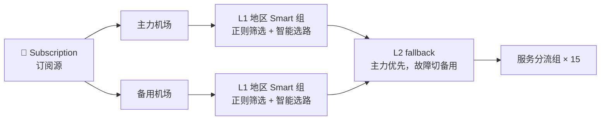

<div align="center">

<picture>
  <source media="(prefers-color-scheme: dark)" srcset="docs/logo-dark.png">
  
</picture>

[](https://github.com/Yixuling/surge-rulekit/actions)
[](https://nssurge.com)

              

[下载现成配置](#下载现成配置) • [引用规则集与图标](#直接引用规则集与图标) • [规则集](#规则集) • [路由架构](#路由架构) • [自己维护](#自己维护)

</div>

[Surge](https://nssurge.com) 的配置与规则集。可以直接下载完整配置，填上订阅链接就能用；也可以只引用 `rules/` 里的规则集和策略组图标，它们补的是社区规则没覆盖的部分（AI 服务、Apple Intelligence、追踪拦截等）。

## 下载现成配置

不想装工具、改模板，可以直接用生成好的完整配置，填上自己的订阅链接就能用：

| 配置 | 适合 |
|---|---|
| [`Surge-Single.conf`](Surge-Single.conf) | 只有一家机场 |
| [`Surge-Dual.conf`](Surge-Dual.conf) | 两家机场，各有一条订阅链接 |
| [`Surge-Merged.conf`](Surge-Merged.conf) | 两家机场的订阅已合并成一条（比如用 [Sub-Store](https://github.com/sub-store-org/Sub-Store) 合并），按节点名里的关键词区分两家 |

1. 在 Surge 里选「从 URL 安装配置」，粘贴对应文件的 raw 链接，比如 `https://raw.githubusercontent.com/Yixuling/surge-rulekit/refs/heads/main/Surge-Single.conf`
2. 编辑这份配置的文本，把标着 👇 的几行换成自己的订阅链接；合并订阅版还要填两家机场的节点关键词
3. 双机场版里 `机场A` 是主力，`机场B` 是备用：各地区优先用 `机场A`，它不通时自动切到 `机场B`

> [!NOTE]
> 装好的配置是一份本地副本，不会跟着仓库更新；规则集和图标通过链接引用，会自动更新。

## 直接引用规则集与图标

把需要的几行加进自己配置的 `[Rule]` 段，策略名换成自己的：

```ini
# 追踪拦截，放在所有规则集之前
RULE-SET, https://raw.githubusercontent.com/Yixuling/surge-rulekit/refs/heads/main/rules/Guard.list, REJECT
# AI 服务（含 IP 段），放在 Google、Twitter 规则之前
RULE-SET, https://raw.githubusercontent.com/Yixuling/surge-rulekit/refs/heads/main/rules/AI.list, AI, no-resolve, extended-matching
# Apple Intelligence，放在 17.0.0.0/8 直连之前
RULE-SET, https://raw.githubusercontent.com/Yixuling/surge-rulekit/refs/heads/main/rules/AppleIntelligence.list, Proxy, extended-matching
# 社区 Global 列表未收录的常用境外服务
RULE-SET, https://raw.githubusercontent.com/Yixuling/surge-rulekit/refs/heads/main/rules/GlobalExtra.list, Proxy, extended-matching
```

其余规则集和用途见[规则集](#规则集)。

策略组图标在组定义末尾加 `icon-url`，文件名就是顶部那排图标的名字，全部在 [`icons/`](icons/)：

```ini
Netflix = select, Proxy, DIRECT, icon-url = https://raw.githubusercontent.com/Yixuling/surge-rulekit/refs/heads/main/icons/Netflix.png
```

> [!TIP]
> 规则集更新后，Surge 按外部资源的更新间隔（默认 24 小时）自动拉取。想马上生效，在 Surge 的「外部资源」里点「更新全部外部资源」。

## 规则集

服务分流的主体直接引用社区规则，本仓库只维护社区没覆盖、更新滞后或不适合直接用的部分。

### 上游规则

| 来源 | 用到的规则 |
|---|---|
| [blackmatrix7/ios_rule_script](https://github.com/blackmatrix7/ios_rule_script) | 微信、App Store、iCloud、Apple 媒体与开发者、TestFlight、YouTube、Google、GitHub、Twitter、Telegram、Netflix、Disney+、PayPal、Speedtest，以及兜底的 Global 与 China 两份大列表 |
| [VirgilClyne/GetSomeFries](https://github.com/VirgilClyne/GetSomeFries) | `ASN.China`，国内 IP 直连 |

上游规则都在模板里通过 raw URL 引用、跟随上游更新，仓库不存副本。感谢 [@blackmatrix7](https://github.com/blackmatrix7) 长期维护这套规则。

### 自维护规则

| 规则集 | 用途 |
|---|---|
| [`AI.list`](rules/AI.list) | OpenAI / Anthropic / Gemini 等 AI 服务（含登录验证域名） |
| [`AppleIntelligence.list`](rules/AppleIntelligence.list) | Apple Intelligence 所需代理域名，与 Apple 官方 [101555](https://support.apple.com/101555) 文档逐条对应 |
| [`AppleExtra.list`](rules/AppleExtra.list) | 社区 Apple 规则未覆盖的账户 API 与媒体边缘域 |
| [`AppleDirect.list`](rules/AppleDirect.list) | App Store 购买 API 与安装包 CDN（直连） |
| [`ArcDia.list`](rules/ArcDia.list) | Arc / Dia 浏览器 |
| [`DeepL.list`](rules/DeepL.list) | DeepL 翻译 |
| [`JetBrains.list`](rules/JetBrains.list) | JetBrains 全家（IDE、Toolbox、插件市场、AI、团队工具），补全上游列表后替代它 |
| [`GlobalExtra.list`](rules/GlobalExtra.list) | Global 列表未收录、实测落到兜底规则的常用境外服务 |
| [`Guard.list`](rules/Guard.list) | 本机实测的纯追踪域名（拦截）；带跳转、风控、表单功能的追踪不收，拦了会坏功能 |

## 路由架构



每家机场的每个地区（香港、新加坡、美国、日本、台湾）各有一个 Smart 组，直接按节点名正则筛选并智能选路；同地区两家机场再由 fallback 做主备切换。两家机场没有混进同一个 Smart 组：实测两家的延迟档位差得多，混编后选路反而不稳。

15 个服务分流组（Apple、AI、Google、Netflix 等）各自独立选择出口：代理、直连、任一地区或具体节点。

## 图标

144×144 透明底 PNG，logo 铺满无底盘。黑色系官方标（Apple、GitHub、X 等）逐个做了双主题处理，深浅色界面下都看得清。

## 自己维护

想按自己的机场和规则长期维护，可以 fork 本仓库，用模板生成配置：私有值留在本地，部署前自动校验，提交前扫描防泄露。步骤见[用模板维护自己的配置](docs/template.md)。
