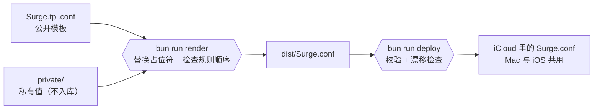

# 用模板维护自己的配置

适合想 fork 本仓库、按自己的机场和规则长期维护配置的人。只想用现成配置或引用规则集，看 [README](../README.md) 就够了。

## 工作方式



模板是 Surge 原生语法加占位符，读起来就是一份完整配置；私有层只有几个变量和片段。改配置只改模板或私有层，渲染与部署由脚本完成。

## 特性

- **模板与私有值分离**：公开模板可以直接给别人参考，敏感值永远不进仓库
- **规则顺序与引用检查**：`[Rule]` 段的先后依赖写成约束表，顺序被打乱时渲染直接报错；引用了未定义的策略或策略组同样报错，不必等 Surge 加载时才发现
- **部署防覆盖**：部署前先校验语法，再比较 iCloud 里的配置有没有在 UI 或 iOS 上被改过，改过就停下并列出语义差异
- **提交前防泄露**：pre-commit 与 commit-msg 两个 hook 用私有层的值扫描暂存内容和提交信息，命中即拒绝
- **自维护规则集**：补[社区规则](../README.md#上游规则)没覆盖或更新滞后的域名，Apple Intelligence 那份与官方文档逐条对应
- **可复现的图标**：15 个策略组图标由脚本生成，上游素材固定版本并校验 sha256，重建逐字节一致

## 准备

需要：

- [Surge for Mac](https://nssurge.com)（部署与语法校验用到其自带的 `surge-cli`）
- [Bun](https://bun.sh)
- 可选：`imagemagick` 与 `librsvg`（重建图标）、[1Password CLI](https://developer.1password.com/docs/cli/)（备份私有层）

先 fork 本仓库，再 clone 自己的 fork：

```bash
git clone https://github.com/<你的用户名>/surge-rulekit.git
cd surge-rulekit
cp -R private.example private   # 私有层，不入库
bun run hooks                   # 启用提交前扫描
```

## 改成自己的配置

模板按「一份订阅里有两家机场的节点」来写：`📡 Subscription` 拉取整份订阅，再按节点名里的关键词分出主力机场和备用机场。两家机场的订阅可以先用 Sub-Store 之类的工具合并成一份。

照着 `private.example/values.env` 里的注释填 `private/values.env`，至少要改这几项：

| 变量 | 填什么 |
|---|---|
| `SECRET_SUB_URL` | 订阅地址 |
| `SECRET_PRIMARY_AIRPORT`、`SECRET_BACKUP_AIRPORT` | 节点名里能区分两家机场的关键词，同时用作这两个策略组的组名 |
| `SECRET_STATIC_KEYWORD` | 专线节点名里的关键词。这些节点不进地区组，单独放进 `🚄 Static` |
| `HTTP_API_KEY` | 本机 HTTP API 的密钥，换成随机串 |
| `SECRET_CA_PASSPHRASE`、`SECRET_CA_P12` | MITM 证书，在 Surge 的 MITM 设置里生成后填入 |

其余私有文件的作用见[模板与私有层](#模板与私有层)。

模板 `Surge.tpl.conf` 按需改：

- **地区**：每个地区的 Smart 组按节点名正则筛选（`policy-regex-filter`），机场的节点命名不同就改正则。增删地区时，Smart 组、fallback 组和 `📍 Regions` 要一起改
- **只有一家机场**：删掉备用机场的子集组和 Smart 组，fallback 组里只留主力机场，再删掉 `values.env` 里备用机场的两个变量（没用到的变量会让 `render` 报错）
- **服务组与规则**：新增服务组后，在 `[Rule]` 加对应的 `RULE-SET`。和别的规则有先后依赖的，在 `src/order.ts` 登记，`render` 会检查
- **自己维护规则或图标**：把模板里的 `Yixuling/surge-rulekit` 换成自己 fork 的路径，否则 Surge 拉的仍是本仓库的文件

改完渲染，确认 `dist/Surge.conf` 无误后再部署：

```bash
bun run render   # 生成 dist/Surge.conf
bun run deploy   # 校验、检查漂移后写入 iCloud 并重载
```

> [!WARNING]
> `deploy` 会覆盖 iCloud 里正在使用的 `Surge.conf` 并让 Surge 重新加载，Mac 与 iOS 同时生效。不用 iCloud 时，用 `SURGE_PROFILE=<路径> bun run deploy` 指定配置文件。

## 命令

| 命令 | 作用 |
|---|---|
| `bun run render [目录]` | 用私有层（默认 `private/`）渲染模板到 `dist/Surge.conf`，同时在根目录生成公开配置 `Surge-*.conf`，并检查规则顺序 |
| `bun run deploy [--force]` | 渲染 → `surge-cli` 校验 → 漂移检查 → 写入 iCloud → 重载 |
| `bun run audit [--speed 主机...]` | 只读列出本月落到 FINAL 的域名，供补规则参考；`--speed` 对比指定主机直连与走代理的首字节耗时 |
| `bun test` | 单元测试（含用 `private.example/` 完整渲染一遍模板） |
| `bun run icons [名称...]` | 重建全部或指定图标，并输出明暗双主题预览图 |
| `bun run hooks` | 启用 `scripts/hooks/` 里的提交扫描，并建立 Claude Code 的 Surge 技能软链 |
| `bun run private:backup` / `private:restore` | 把 `private/` 打包存入 / 取回 1Password |

## 模板与私有层

模板里有两种占位符：

- `{{变量名}}`：替换为 `private/values.env` 中的同名变量
- `{{> 片段名}}`：独占一行，内联 `private/snippets/片段名.conf` 的多行内容

模板开头第一段注释只描述模板本身，渲染时会换成「由模板生成，勿直接编辑」的说明。

| 私有层文件 | 内容 |
|---|---|
| `values.env` | 模板变量，`KEY=value`。`SECRET_` 开头的值会进入提交扫描清单 |
| `snippets/*.conf` | 多行私有片段，如本地直连规则；其中出现的域名会进入扫描清单 |
| `deny.txt` | 扫描清单的补充：被截断、换写法或本身太短的敏感片段，每行一条 |
| `state/` | `deploy` 记录的上次部署内容，用于漂移检查 |

> [!IMPORTANT]
> 未定义的变量、缺失的片段、没用到的变量或片段、写错格式的占位符，都会让 `render` 直接失败，不会产出半成品配置。新增变量时记得同步在 `private.example/` 里加示例值，否则 CI 会失败。

没有私有值可扫描的 fork，用 `git config surge-rulekit.allow-no-private true` 放行提交扫描。

## 重建图标

```bash
bun run icons              # 全部重建 + 明暗预览
bun run icons Netflix AI   # 只重建指定图标
```

上游素材（simple-icons、dashboard-icons 等）固定到版本或 commit，下载后按 [`scripts/icons.lock`](../scripts/icons.lock) 校验 sha256；上游内容变化时脚本直接失败，不会静默产出不同的图。升级来源后用 `UPDATE_LOCK=1 bun run icons <名称>` 重新记录。新增图标的步骤见脚本头部注释。

## 项目结构

```
Surge.tpl.conf        配置模板
Surge-*.conf          公开配置（由模板生成，可直接下载）
private.example/      私有层示例（复制为 private/ 后填值）
rules/                自维护规则集
icons/                策略组图标（由脚本生成）
src/                  渲染、公开配置转换、顺序约束、策略引用检查、规范化与私有层读取
src/cli/              render、deploy、scan、audit 命令入口
src/tests/            单元测试
scripts/              图标生成脚本与 git hooks
```

维护约定与架构决策见 [AGENTS.md](../AGENTS.md)。
